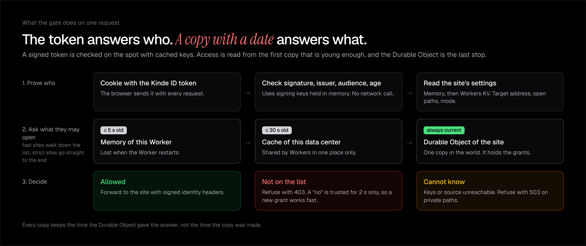
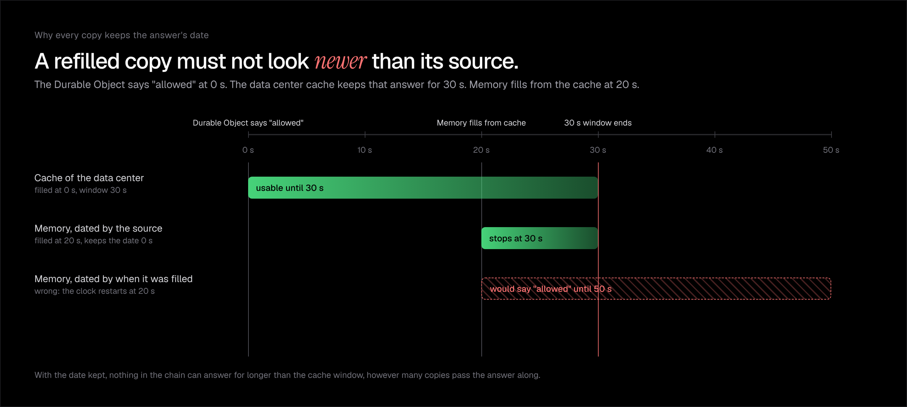

# Wicket

Put a staging or preview site behind a sign-in, at the edge, and take people back out when the work is done.

You share a staging site with a client, a teammate or a reviewer. Wicket puts a gate in front of it. Each visitor signs in with their own email address, and only the emails you invite can open the site. When you remove an email, the site closes to that person. An invitation can also expire on its own.

Wicket runs as a Cloudflare Worker that you deploy to your own account. Kinde handles the sign-in and the plan limits. Your site does not change, and it does not need to know about either one.



## Why it exists

A signed token proves who someone was when they signed in. A cache holds an answer that was true some seconds ago. Neither one says whether a person still has access right now, and that is the question you ask when you remove someone.

Wicket answers that question with a rule you can state. Every copy of an access answer carries the time the source gave it, each copy has a freshness window, and the gate refuses to use a copy older than its window. You choose the window per site:

| Mode | A removed person is refused after | How |
| --- | --- | --- |
| `fast` (default) | up to 30 seconds | Answers come from memory, then the data center cache, then the site's Durable Object |
| `strict` | one round trip (0.21 s median in a deployed test) | Every request asks the Durable Object |

On a deployed gate, measured from a laptop in Lagos, the `strict` mode added 8 ms at the median over an answer from memory.



## What you need

- A Cloudflare account. The free plan is enough to start.
- A Kinde account with billing turned on, and one Kinde application for sign-in.
- Node 20 or later.

## Set it up

**1. Kinde.** In your Kinde dashboard:

1. Create a back-end (machine-to-machine) application that can read billing entitlements. Keep its client ID and secret.
2. Create a front-end web application for sign-in. Turn on email sign-in. Add these callback URLs, with your own gate address in place of the placeholder: `https://<your-gate>.workers.dev/_wicket/callback`, `https://<your-gate>.workers.dev/app` and `http://localhost:8976/callback` (for the command line tool). Add `https://<your-gate>.workers.dev/` as the logout URL.
3. Add a numeric feature with the code `protected_sites` to your plans. The example plans use Free 1, Pro 10 and Business unlimited. A customer on a plan version that was published before you added the feature keeps the old version, so move those customers off the plan and back on.

**2. The gate.** In this folder:

```bash
npm install
cp .dev.vars.example .dev.vars    # fill in your Kinde machine-to-machine keys and a long random signing secret
```

Edit `wrangler.toml` and set `KINDE_DOMAIN` (for example `https://yourname.kinde.com`) and `KINDE_CLIENT_ID` (the sign-in application's client ID). Edit `public/config.js` and list your organizations, so the dashboard can sign in to the right one. Then deploy and upload the four secrets:

```bash
npm run deploy
npx wrangler secret put KINDE_M2M_CLIENT_ID
npx wrangler secret put KINDE_M2M_CLIENT_SECRET
npx wrangler secret put CUSTOMERS_JSON     # {"org_xxx":"customer_xxx"}: organization code to Kinde billing customer ID
npx wrangler secret put SIGNING_SECRET
```

**3. Protect a site.** Sign in with the command line tool and protect your first site:

```bash
cd cli && npm install && npm run build
node dist/index.js login org_xxx --url https://<your-gate>.workers.dev
node dist/index.js protect https://your-staging-site.example --name preview
node dist/index.js invite preview client@example.com --hours 72
```

The `protect` command prints the address to share. The visitor opens it, signs in with the invited email, and sees your site. The command line tool in `cli/` is packaged as [`wicket-gate`](cli/README.md).

## Use it

| Command | What it does |
| --- | --- |
| `wicket protect <url> [--name n] [--strict] [--open path]` | Protect a site. `--open` leaves a path, such as `/health`, public. |
| `wicket invite <site> <email> [--hours n]` | Let a person in, and optionally for a set time. |
| `wicket revoke <site> <email>` | Take a person out. |
| `wicket people <site>` | List who may open the site. |
| `wicket list` | List your sites and their modes. |
| `wicket remove <site>` | Stop protecting a site. |

You can do the same from the dashboard at `/app` on your gate.

Your site receives four extra headers on each request: `x-wicket-site`, `x-wicket-email`, `x-wicket-ts` and `x-wicket-signature`. The signature is an HMAC with SHA-256 over the other three, made with your `SIGNING_SECRET`. Verify it, and reject a timestamp older than 60 seconds, if your site needs to know who is looking. The gate removes any `x-wicket-` header that a browser sends.

## What happens when Kinde is unreachable

The gate checks sign-in tokens with copies of Kinde's signing keys. It reads them again every 300 seconds. If Kinde does not answer, the gate keeps using the old copy for up to 24 hours, and then it refuses with 503. A gate that has no keys and cannot reach Kinde also answers 503, so a visitor with a good token is not told to sign in again. Paths you mark open skip the check and keep working.

## Settings

Set these under `[vars]` in `wrangler.toml`.

| Variable | Default | Meaning |
| --- | --- | --- |
| `KINDE_DOMAIN` | none | Your Kinde address |
| `KINDE_CLIENT_ID` | none | The sign-in application's client ID |
| `FEATURE_CODE` | `protected_sites` | The Kinde feature that sets how many sites a plan allows |
| `MEMORY_WINDOW_MS` | `5000` | How old an answer in memory may be on a fast site |
| `CACHE_WINDOW_MS` | `30000` | How old an answer in the data center cache may be on a fast site |
| `DENY_WINDOW_MS` | `2000` | How long a "no" is trusted, so a new invitation works quickly |
| `JWKS_REFRESH_S` | `300` | How often the gate reads Kinde's signing keys |
| `JWKS_MAX_STALE_S` | `86400` | How long old keys may be used when Kinde does not answer |
| `MAX_TOKEN_AGE_S` | `3600` | The gate refuses a token issued longer ago than this |
| `REQUIRED_PERMISSION` | empty | A Kinde permission that an owner needs to manage sites |
| `ALLOW_SIMULATION` | `1` | Lets a test request ask the gate to act as if Kinde were down. It can only make that request fail. Set it to `0` to turn it off. |

## Measure it yourself

The scripts use the sign-in that `wicket login` saves. Each one creates and removes its own test sites, so you need room for two sites on your plan.

```bash
node scripts/tiers.mjs          # round trip and time in the gate for each tier (add --long for more requests)
node scripts/revoke.mjs 8       # time from revoke to refusal, fast and strict, 8 rounds each
node scripts/kinde-down.mjs 60  # simulate a Kinde outage with a 60 second stale limit
```

To run the whole gate on your computer against a fake Kinde and a fake site, follow the steps at the top of `scripts/local-e2e.mjs`.

## Develop

```bash
npm test             # unit tests for the tiers, keys, sessions, limits and signed headers
npm run typecheck
```

## License

MIT
