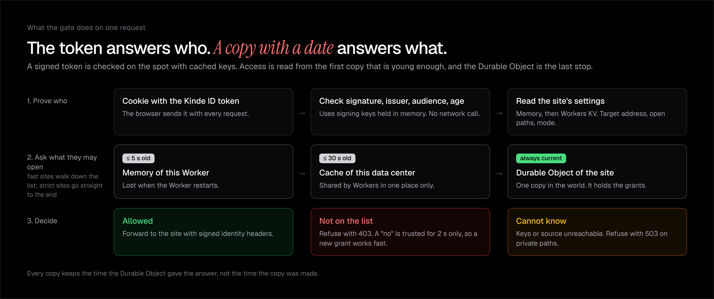

# wicket-gate

The command line tool for [Wicket](https://github.com/sholajegede/wicket). It protects a staging or preview site behind a sign-in, and it invites or removes people from the terminal.

Wicket is a gate that runs as a Cloudflare Worker in your own Cloudflare account. A visitor signs in with their email through Kinde, and the gate lets in only the emails you invited. This tool talks to your gate. It does not run the gate, so deploy the gate first by following the setup steps in the [Wicket repository](https://github.com/sholajegede/wicket#set-it-up).



## Why use it

You can protect a site, invite a client for 72 hours, and take the client out again without opening a dashboard. Each invitation belongs to one email address, so removing a person closes the site to that person and to nobody else.

## Start

You need Node 20 or later and the address of your deployed gate.

```bash
npx wicket-gate login org_xxx --url https://<your-gate>.workers.dev
npx wicket-gate protect https://your-staging-site.example --name preview
npx wicket-gate invite preview client@example.com --hours 72
```

`login` opens your browser to sign in through Kinde, for the organization you name. `protect` prints the address to share with your visitor. To use the shorter command `wicket`, install the package globally with `npm install -g wicket-gate`.

## Commands

| Command | What it does |
| --- | --- |
| `wicket login [org_code] --url <gate address>` | Sign in. Run it once per computer. |
| `wicket logout` | Delete the saved sign-in. |
| `wicket whoami` | Show the organization and gate you are signed in to. |
| `wicket protect <url> [--name <name>] [--strict] [--open <path>]` | Protect a site. `--open` leaves a path, such as `/health`, public. Repeat it for more paths. |
| `wicket list` | List your sites, their modes and the address to share. |
| `wicket people <site>` | List who may open a site. |
| `wicket invite <site> <email> [--hours <n>]` | Let a person in. With `--hours`, the invitation expires on its own. |
| `wicket revoke <site> <email>` | Take a person out. |
| `wicket remove <site>` | Stop protecting a site. |

You can name a site by its slug, its id, or the start of its name.

## Fast or strict

A `fast` site, which is the default, answers from memory and a data center cache. A removed person is refused within 30 seconds. A `strict` site asks the site's Durable Object on every request, and a removed person is refused after one round trip. Pass `--strict` to `protect` when removing a person has to close the site at once. After `revoke`, the tool tells you which promise applies.

## Where it keeps your sign-in

The tool saves your sign-in in `~/.config/wicket/credentials.json`, readable only by you. Set `XDG_CONFIG_HOME` to change the folder. For a script or a continuous integration job, set `WICKET_TOKEN` and `WICKET_URL` instead of signing in.

## Plans

Your Kinde plan sets how many sites you can protect. When you reach the limit, `protect` says so and shows the limit. `wicket list` prints `used of limit sites`.

## License

MIT
